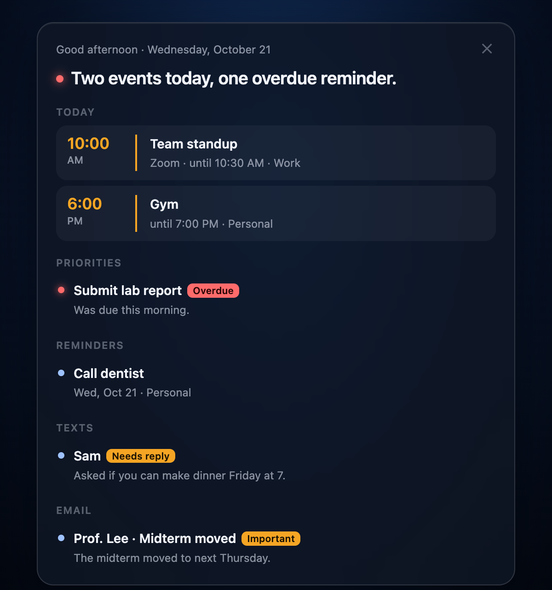

# Jarvis Orb

A glowing orb that lives on your macOS desktop and fronts a Claude agent. Click it (or press
⌃⌥Space), speak or type, and Jarvis answers out loud, works on your Mac while you watch, and asks
before it does anything that sends, deletes, buys or changes something.

<p align="center">
  
  
</p>

The orb sits just above the desktop icons and below every window, so it is only visible on the
bare desktop and never gets in the way. It reacts to the cursor, changes colour with what it is
doing (listening, thinking, waiting for your OK, speaking, error), and warms up when a reminder
is overdue.

## What it does

- **Talk to Claude from the desktop.** Replies stream into a small chat panel under the orb and
  are read aloud, the text appearing as it is spoken. The chat keeps its context; a quiet hour
  starts a fresh one.
- **Approve/Deny cards.** Reading and searching run freely. Anything that sends, deletes,
  changes, buys or posts shows a card naming the exact action first. Nothing runs without
  *Approve*; every action and answer is logged locally.
- **Calendar and Reminders** through EventKit: "what's on today?", "add the dentist Tuesday at
  3:30" (with a card), overdue reminders.
- **Daily briefing.** The first time you open the Mac each day, a card shows today's events,
  priorities, reminders, what people asked you over text (one-on-one chats) and important email,
  and Jarvis reads a short summary.
- **Quick actions** without cards: open apps, folders and sites, volume, timers (the orb chimes
  and says the label), Spotlight search, Do Not Disturb.
- **Memory.** Jarvis keeps a small profile of your preferences, routines, projects and people,
  plus recent requests, and loads them into each conversation. You can read or edit it from the
  orb's menu.
- **Browser tasks** in a visible Chrome tab through Claude in Chrome (for example Gmail drafts).
- **Voice in:** type, or dictate with [Wispr Flow](https://wisprflow.ai) (the orb can start Wispr
  for you). **Voice out:** ElevenLabs, then [Kokoro](https://github.com/thewh1teagle/kokoro-onnx)
  (free, on-device), then the built-in Mac voice.

## How it works

- `app/`: the macOS app (Swift/AppKit). A borderless window at desktop level hosts the orb in a
  `WKWebView`, the chat panel, the cards and the briefing.
- `orb-web/`: the orb itself, raw WebGL2 (no libraries), plus the briefing card. Both open in a
  normal browser for quick iteration.
- `agent/`: a small Node helper (no npm dependencies) that runs your own
  [Claude Code](https://code.claude.com) headless (`claude -p`, signed in with your claude.ai
  account) and talks to the app over stdin/stdout JSON lines. It also holds the approval hook,
  memory, quick-action and Kokoro scripts.
- `app/CalendarTool`, `app/MessagesTool`: two small command-line tools bundled into the app for
  calendar/reminders (EventKit) and recent one-on-one messages (read-only).

More detail in [docs/ARCHITECTURE.md](docs/ARCHITECTURE.md).

## Requirements

- macOS 15 or later (built and tested on macOS 27, Apple Silicon)
- Xcode 16 or later
- Node.js 20 or later (Homebrew: `brew install node`)
- [Claude Code](https://code.claude.com) installed at `~/.local/bin/claude` (or set
  `JARVIS_CLAUDE_PATH`) and signed in with a claude.ai Pro or Max account

Optional:

- Google Chrome with the Claude in Chrome extension, for browser tasks
- The claude.ai Gmail connector, for email in the briefing
- Wispr Flow, for dictation
- An ElevenLabs API key, for the best voice; or Kokoro (free, `scripts/setup-kokoro.sh`)

## Setup

```bash
git clone https://github.com/cadenladov21-cloud/jarvis-orb.git
cd jarvis-orb

# Pick your own app ID once and keep it: macOS ties permissions and settings to it.
cp local.env.example local.env   # then edit BUNDLE_ID

# Optional but recommended: a local code-signing certificate, so macOS keeps the app's
# permissions (Accessibility, Full Disk Access) across updates.
scripts/create-signing-cert.sh

# Build, install to ~/Applications and start (it opens at login from then on).
scripts/install.sh
```

Sign Claude Code in with your claude.ai account. If your shell exports `ANTHROPIC_API_KEY`, hide
it for this one command, because the orb deliberately ignores API keys and uses your login:

```bash
env -u ANTHROPIC_API_KEY claude auth login
```

### Permissions

macOS asks the first time each feature is used. All of them are optional.

| Feature | Permission |
|---|---|
| Calendar, Reminders | Calendars, Reminders (Allow when asked) |
| Texts in the briefing | Full Disk Access for Jarvis Orb (System Settings › Privacy & Security), plus Contacts for names |
| Orb starts Wispr for you | Accessibility for Jarvis Orb |
| Do Not Disturb | Two Shortcuts you create: "Jarvis DND On" and "Jarvis DND Off" (each one "Set Focus" action) |

### Voices

- **ElevenLabs:** store your key in the Keychain (it is never written to disk or logs):
  `security add-generic-password -a "$USER" -s JarvisOrb-ElevenLabs -w`
- **Kokoro:** `scripts/setup-kokoro.sh` installs it into its own folder (~340 MB). Jarvis switches to
  it automatically when ElevenLabs runs out of credits.
- Right-click the orb › **Voice** to choose.

## Using it

- **Click the orb** or press **⌃⌥Space**, then type or dictate. Return sends; Esc cancels.
- **Right-click the orb** for Model (Sonnet 5.5 or Opus 5.5), Speak Replies, Voice, Voice Input,
  New Chat, Memory, Daily Briefing, Open at Login and Quit.

## Privacy and safety

- Everything runs on your Mac with your own Claude Code login. The orb ignores API keys in the
  environment, and keys you add (ElevenLabs) live in the Keychain.
- What Jarvis remembers, your recent requests and chat sessions stay on your Mac in
  `~/Library/Application Support/JarvisOrb` and Claude Code's own session folder. The activity
  log (`~/Library/Logs/JarvisOrb`) records which tools ran and your Approve/Deny answers, never
  your requests or the replies.
- Request text, calendar items, messages and email you ask about are sent to Claude to answer
  you; reply text is sent to ElevenLabs when that voice is on.
- Jarvis can act on your computer. Writes go through Approve/Deny cards, but read what a card
  says before approving it.

## Development

```bash
scripts/run.sh                       # debug build, run from build/DerivedData
python3 -m http.server 5178 --directory orb-web   # orb at http://localhost:5178/?fps
```

See [CLAUDE.md](CLAUDE.md) for commands, debug flags and conventions.

## Disclaimer

An independent hobby project. Not affiliated with or endorsed by Anthropic, Marvel, ElevenLabs or
Wispr. "Jarvis" is a nod to the films.

## License

MIT; see [LICENSE](LICENSE). Kokoro's model is Apache 2.0 and is downloaded separately.
